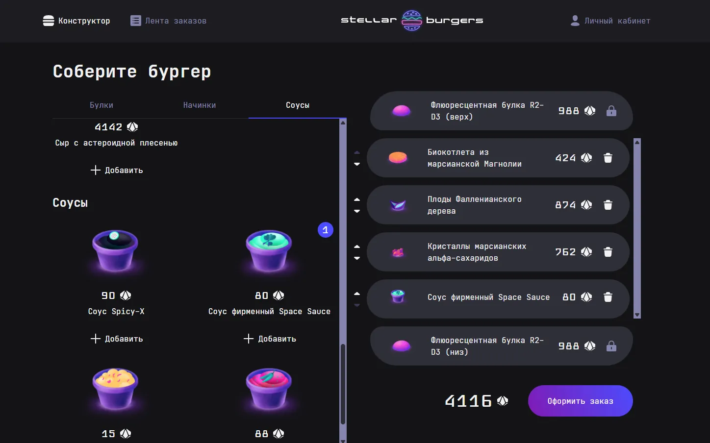

# Stellar Burgers

Stellar Burgers is a React and TypeScript application for building custom burgers, placing orders and working with a live order feed.

The project was built on top of a provided starter interface. My work focused on the application layer: state management, routing, authentication, API integration and automated testing.

## Screenshot



## My contribution

I implemented the main frontend application logic, including:

- Redux state management and asynchronous actions;
- API integration and request handling;
- registration, login, logout and session restoration;
- token refresh logic;
- protected routes and post-login navigation;
- order creation and personal order history;
- public order feed behavior;
- modal routing for ingredients and orders;
- automated tests for the implemented flows.

## Key features

- burger constructor based on ingredients loaded from an external API;
- authenticated and protected user areas;
- profile and personal order history;
- public order feed;
- ingredient and order details;
- token-based authentication;
- asynchronous state handling with Redux Toolkit.

## Technical decisions

Application state is centralized in Redux Toolkit. Asynchronous API operations are separated into dedicated actions and slices so loading, error and success states remain predictable across the interface.

Protected routing keeps unauthenticated users away from private pages and preserves navigation intent around the login flow.

Ingredient and order details can open as modal routes while still supporting direct navigation to dedicated pages.

The test suite covers both application logic and user-facing flows.

## Tech stack

- React 18
- TypeScript
- Redux Toolkit
- React Redux
- React Router
- Webpack
- Jest
- React Testing Library
- Playwright
- Storybook

## Testing

Jest and React Testing Library are used for component and application-level tests. Playwright covers end-to-end scenarios.

Useful commands:

```bash
npm run test
npm run test:coverage
npm run test:playwright
```

## Run locally

```bash
git clone https://github.com/alexeydev42/stellar-burgers.git
cd stellar-burgers
npm install
npm start
```

Create an `.env` file from `.env.example` and provide the API URL required by the project.

Other useful commands:

```bash
npm run lint
npm run storybook
```

## Project context

This project was developed during the Yandex Practicum Frontend Developer program using a prepared UI foundation. The main development work in this repository is the frontend application logic and its integration with routing, state, API and tests.
